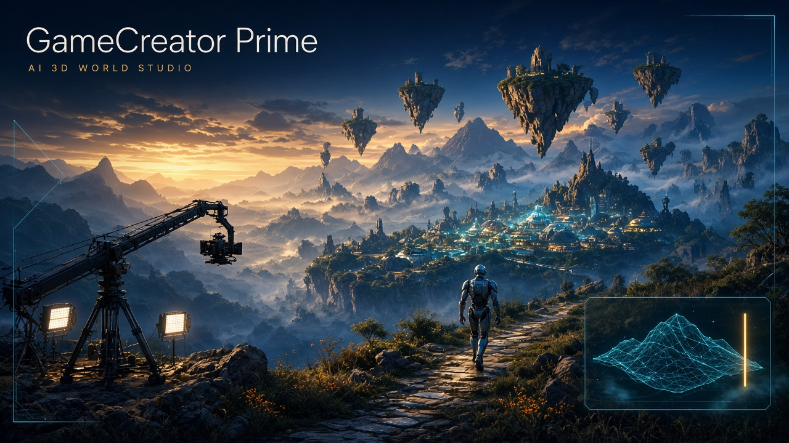

# GameCreator Prime



Premium, free-to-ship **AI world studio**. An agent harness drives [Blender](https://www.blender.org/) through Python — the same class of work as a 3D world generator, built so you can run it locally with **Ollama Cloud** or any other model provider.

It is a game-design tool first. Cinematics are part of that, not a separate film-only toy.

## What it is for

### Embodiment & robotics
Teach an AI body to exist in space: walk, collide, climb, and manipulate objects with real rigid-body physics, capsules, grasp targets, and waypoint paths.

### Generative play
Grow a video-game world **while the player is standing in it**. Text or voice prompts shift terrain, open wings, and spawn encounters without resetting the level.

### Direction (games + film)
A virtual director for **game cameras and cutscenes**: follow cams, lock-ons, dollies, light arrays, simple skeletal animation, and a handoff from previs to playable framing.

## Stack

- **Electron + React + TypeScript** desktop studio
- **Blender 4.2+** headless (`bpy`) via the GameCreator Prime SDK
- **Multi-provider LLM harness** with tool calling:
  - Ollama Cloud (GLM-5.3, Kimi K3, Qwen 3.5, GPT-OSS, …)
  - Ollama Local (including `:cloud` models)
  - OpenAI, Anthropic, Gemini, Groq, OpenRouter, Moonshot AI
  - Any OpenAI-compatible endpoint

## Setup

```bash
npm install
npm run dev
```

1. Install [Blender 4.2+](https://www.blender.org/download/). The app auto-detects it on Windows; otherwise set the path in **Providers**.
2. Create an [Ollama Cloud API key](https://ollama.com/settings/keys) (or another provider key) and paste it in **Providers**.
3. Pick **Embodiment**, **Generative Play**, or **Direction**, write a brief (or use **Voice**), and run the agent.

In **Providers**, use **Refresh models** to load the models available to your
account, or enter an exact model ID. You can refresh using a newly entered key
before saving it. Choose a model that supports tool calling, then save your
settings. Keys are read from the app's Providers settings; `.env` files are not
loaded. See [model sources and availability](docs/model-catalog.md) for the
curated presets and the status of Kimi K3.1 Pro.

Worlds are stored in `Documents/GameCreatorPrime/worlds`.

## How the harness works

1. You give a world brief (or a live in-world prompt).
2. The agent plans, then writes Python against `blender/runtime/gcp.py` — not raw one-off `bpy` soup.
3. Blender runs headless, saves `world.blend`, dumps `scene.json`, and renders a preview still.
4. The agent inspects physics, spawns, cameras, and iterates.
5. Live prompts mutate the existing `.blend` instead of wiping the player’s surroundings.

## Package

```bash
npm run dist:win
```

Windows releases are built on native Windows runners by the
`Windows release` workflow. Push a version tag matching `package.json` (for
example `v1.1.0`) to run provider tests, TypeScript checks, and build a Windows
x64 installer. The release contains only the installer and `SHA256SUMS.txt`.
Blender 4.2+ is installed separately; installers are unsigned unless signing is
configured.

Development checks:

```bash
npm test
npm exec tsc -- -b
npm run build
blender --background --factory-startup --python-exit-code 1 --python blender/runtime/selftest.py
```

Use Node.js 24 for the dependency-free TypeScript test runner.

## License

**Copyright © 2026 Aaron Grace. All rights reserved.**

GameCreator Prime is proprietary. No MIT (or other) public license is granted. You may not copy, fork, redistribute, sell, or make derivative works without a written grant from Aaron Grace. See [LICENSE](LICENSE).

Massachusetts law and U.S. federal copyright apply. Unauthorized copying may be pursued in the U.S. District Court for the District of Massachusetts.
